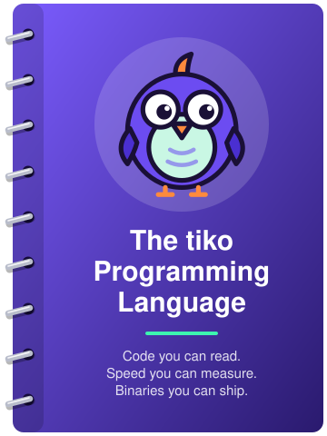

<p align="center">
<picture>
  <source media="(prefers-color-scheme: dark)" srcset="brand/tiko-logo-on-dark.svg">
  
</picture>
</p>

<h3 align="center">Code you can read. Speed you can measure. Binaries you can ship.</h3>

**tiko is a compiled, statically typed programming language for building fast, self-contained
programs.** Its syntax is built to be read: blocks say what they close, keywords are words, and
there is very little punctuation to learn. Underneath it is a systems language — generics, tuples,
lambdas, typed errors, channels, direct use of C headers — compiled through LLVM to native code,
with no virtual machine and no garbage collector.

```vb
#import "std/containers"
#import "std/strings"

'' Count the words in a sentence and return the most common one.
function MostCommon( byval text as ustring ) as (word as ustring, count as int32)
    dim counts as containers.Map( of ustring, int32 )
    for each w as ustring in strings.Split( LCase( text ), " " )
        counts[ w ] += 1
    next

    dim as ustring best
    dim as int32 most = 0
    for each e in counts
        if e.Value > most then best = e.Key : most = e.Value
    next
    return (best, most)
end function

var (word, n) = MostCommon( "the quick brown fox jumps over the lazy dog the end" )
print "'" & word & "' appears " & n & " times"
```

```
'the' appears 3 times
```

## Why tiko

- **Readable by design.** Code reads top to bottom as prose. `end function`, `next`, `end if` —
  every block says what it closes, so a reviewer never counts braces.
- **C-class speed.** tiko has its own compiler front end and typed IR, then hands LLVM IR to
  clang. On the first two benchmarks it is within 10% of the same code written in C, and level
  with it on one of them ([bench/](bench/README.md)).
- **Tiny, dependency-free executables.** Hello world is a 23 KB `.exe` that imports only
  `kernel32.dll` and `ucrtbase.dll`, both part of Windows. You don't install a runtime and you
  don't need Visual Studio.
- **No garbage collector, no pauses.** Strings and containers free themselves at the end of
  their scope. `defer` covers everything else, and `SharedPtr` handles shared ownership.
- **Concurrency built into the language.** `spawn` a procedure, pass values through typed
  `Channel`s, and wait on several at once with `select channel`.
- **Reads C headers directly.** `#cinclude "sqlite3.h"` imports a C library's own header through
  libclang. You don't write a binding.
- **Batteries included.** Containers, sorting, `Result`/`Optional`, filesystem, date and time,
  math, exact money types, structured logging and a terminal UI toolkit all ship with the
  compiler.
- **Written in itself.** The tiko compiler is a tiko program. Built by itself twice, it produces
  byte-identical binaries on both Windows and Linux.

## The tiko-lang book

<a href="https://tiko-lang.net/book/"></a>

***The tiko Programming Language*** is a book for programmers who know another language and are
new to tiko. It teaches tiko as a language in its own right, and it is written in the tradition
of *The Rust Programming Language* and K&R: the basics move briskly, and the idioms get room.

It starts with the basics (types, control flow, procedures, arrays and strings), then builds
abstractions (types, objects, modules, generics, errors, testing). It goes on to the advanced
language (tuples, iterators, lambdas, `defer`, concurrency), the standard library, and systems
programming: C interop with `#cinclude`, and building and shipping. It ends with three complete
projects: a command-line search tool, a concurrent pipeline and a terminal-UI ledger.

Every listing in the book is a real program, compiled and run on Windows and Linux with its
output checked. The book is being written.

- **Read it online:** [tiko-lang.net/book](https://tiko-lang.net/book/), an mdBook.
- **Download the PDF:** [the-tiko-programming-language.pdf](https://tiko-lang.net/book/the-tiko-programming-language.pdf).

<br clear="right">

## A tour in four snippets

**Errors are values.** A fallible call returns a `Result`, so no exception can escape
unannounced and there is no error code to forget.

```vb
#import "std/fs"

var r = fs.ReadAllText( "settings.ini" )
if r.IsOk( ) then
    print len( r.Value( ) ); " characters"
else
    print "cannot read settings.ini: "; r.Failure( ).Message( )
end if
```

**`defer` cleans up on every path out of a scope**, in reverse order: fall-through, `return`,
`exit` and `goto`.

```vb
sub Work( )
    print "open"
    defer print "close"
    for i as int32 = 1 to 3
        if i = 2 then return      '' "close" still prints
        print "step"; i
    next
end sub
```

**Channels, not locks.** Arguments are copied at the `spawn`, and a `for each` over a channel
ends when the sender closes it.

```vb
#import "std/tasks"

sub Squares( byval out_ as tasks.SendChan( of int32 ), byval n as int32 )
    for i as int32 = 1 to n
        out_.Send( i * i )
    next
    out_.Close( )
end sub

dim results as tasks.Channel( of int32 ) = tasks.Channel( of int32 )( 8 )
spawn Squares( results, 5 )

dim as int32 total = 0
for each v in results
    total += v
next
print "sum of squares:"; total       '' 55
```

**Generics and lambdas.** A non-capturing lambda is a plain function pointer, so it also works
with C callbacks.

```vb
#import "std/containers"

type Point
    x as float64
    y as float64
end type

dim pts as containers.Array( of Point )
pts.Push( type( 3, 4 ) ) : pts.Push( type( 1, 1 ) ) : pts.Push( type( 0, 2 ) )

containers.SortBy( pts, function( byref a as const Point, byref b as const Point ) as boolean
    return a.x * a.x + a.y * a.y < b.x * b.x + b.y * b.y
end function )
```

**And C, with no binding layer:**

```vb
#cinclude once "math.h"

print "cube root of 27 ="; cbrt( 27.0 )
```

Every snippet on this page was compiled and run with the packaged Windows toolchain on
2026-09-30.

## Diagnostics that point at the problem

```
area.tiko(5,35): error TKO0698: this argument does not convert to the parameter's type
     |
   5 | dim total as float64 = Area( 3.0, "four" )
     |                                   ^
```

Every diagnostic has a stable `TKOnnnn` id, a location and a caret. Add
`--diagnostics-file` to write them all as machine-readable records for editors and CI.

## At a glance

| | |
| --- | --- |
| **Compiles to** | Native x86-64 executables, DLLs / shared objects and static libraries, through LLVM |
| **Platforms** | Windows x86-64 (MSVC ABI, no Visual Studio needed) and Linux x86-64 |
| **Types** | Static, with inference (`var`), fixed-width names (`int32`, `uint8`, `float64`, …), generics, tuples, UDTs with methods, properties, operator overloading, single inheritance and virtual methods |
| **Memory** | Deterministic: scope-based destruction, `defer`, `SharedPtr` / `WeakPtr`; no GC |
| **Errors** | `Result( of T, E )` and `Optional( of T )`, plus runtime checks up to array bounds and null pointers with `-exx` |
| **Concurrency** | `spawn` onto a thread pool, typed channels, `select channel`, `WaitGroup`, cancellation contexts |
| **C interop** | `#cinclude` imports C headers via libclang; `#foreignlib` links libraries shipped inside your source tree |
| **Tooling** | Language server, tree-sitter grammar, source-level debugging through lldb-dap, a unit-test framework, an editor |

## Standard library

| | |
| --- | --- |
| Collections | `Array`, `Map`, `Set`, `LinkedList`, `OrderedMap`, `OrderedSet` |
| Algorithms | introsort, stable merge sort, 37 string algorithms (`Split`, `Join`, `Replace`, …) |
| Values | `Result`, `Optional`, `SharedPtr`, `WeakPtr`, `ustring` (UTF-16 on every platform) |
| System | filesystem (paths, directory walks, globbing, file watching, memory mapping), date and time with time zones and a monotonic clock |
| Numbers | math, statistics, vectors and matrices, seeded random streams, exact `Currency` and `Decimal`, finance functions |
| Apps | structured logging, a terminal UI toolkit |

Reference pages for each are in the [Feature Index](wiki/Feature-Index.md).

## Tooling

- **[tiko-lsp](https://github.com/PaulSquires/tiko-lsp):** a language server with completion,
  hover, go-to-definition, rename, signature help, semantic highlighting, inlay hints,
  formatting and quick fixes. It works in any LSP editor and ships with a tree-sitter grammar.
- **[tiko-editor](https://github.com/PaulSquires/tiko-editor):** a native Windows editor with an
  integrated debugger.
- **Debugging:** `-g` emits DWARF with variables and types, which gdb and lldb can read.
- **Testing:** the toolchain ships a unit-test framework.

## Getting started

tiko is **pre-1.0** (`0.1.0-dev`), and there are no binary releases yet. To build a toolchain
for the machine you are on, run this from Git Bash on Windows, or from Linux:

```bash
bash build/package.sh --verify
```

This produces `toolchains/tiko-windows/` or `toolchains/tiko-linux/`. The toolchain is a
self-contained directory: move it anywhere, and it finds its own headers and libraries. Building
it needs FBC-Modern as the bootstrap compiler.

**You need clang 18 or newer,** which tiko uses to assemble and link. It is not bundled. tiko
looks for it at `C:\Program Files\LLVM\bin\clang.exe` or `/usr/bin/clang`, or wherever
`TKO_CLANG` points.

```bash
tiko hello.tiko          # hello.exe on Windows, ./hello on Linux
tiko -O2 app.tiko        # optimised
tiko -g -exx app.tiko    # debug info and full runtime checks
tiko -mt app.tiko        # the thread-safe runtime, required by spawn and channels
```

Source files are `.tiko` and headers are `.ti`. `tiko --help` lists every option.

## Status

- **Self-hosting.** Built by itself twice, the compiler is byte-identical at `-O0` and `-O2`,
  on Windows and on Linux (2026-09-21).
- **Tested.** 1,058 suite tests pass (2026-09-24). Behaviour is checked differentially: 2,000
  fuzz-generated programs print the same output as under the reference implementation.
- **Not there yet:** macOS and ARM64 targets, binary releases and installers, a package
  manager, and CodeView debug info. Graphics links on Windows only.

## Coming from FreeBASIC

tiko compiles FreeBASIC 1.20 code (`#lang "fb"`). All 68 in-scope run-and-compare programs in
fbc's own test corpus print what fbc's builds print, byte for byte, and so do the 2,000
fuzz-generated programs. `.bas` and `.bi` files are still recognised, and they mix freely with
`.tiko` and `.ti`.
What differs, what is refused and why is on
[Compatibility](wiki/Compatibility.md).

## Documentation

| | |
| --- | --- |
| [Feature Index](wiki/Feature-Index.md) | the language features and the standard library, one page each |
| [Language reference](wiki/Home.md) | every keyword, operator and intrinsic |
| [Goroutines tutorial](wiki/Modern-Goroutines-Tutorial.md) | concurrency from first `spawn` to cancellation |
| [C header import tutorial](wiki/modern-Cinclude-tutorial.md) | using a C library with no binding |
| [bench/](bench/README.md) | the benchmarks and how to run them |

## Licence

The compiler is **GPL v2 or later**. The runtime and graphics libraries are **LGPL v2.1 or later
with a static-linking exception**. **Your programs are yours**: whatever you build with tiko, you
may distribute on any terms you choose. [LICENSE](LICENSE) maps each part of the repository to its
licence.
