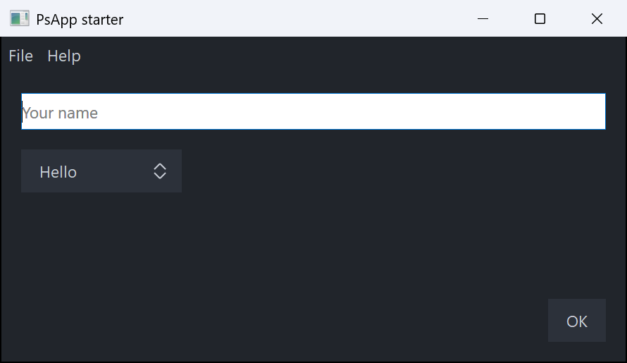

# PsApp

The application framework for PsControls. `PsApplication` handles start-up, the message loop and
tear-down. A `PsForm` is a window whose messages arrive as callbacks.

```freebasic
#import "vendor/PsControls/PsApp"
#import "vendor/PsControls/PsButton"
using PsApp
using PsButton

sub frmMain_OnSize( byval f as PsForm ptr, byval cx as long, byval cy as long )
    SetWindowPos( f->Item( 1001 ), null, cx - f->ScaleX( 100 ), cy - f->ScaleY( 44 ), _
                  f->ScaleX( 88 ), f->ScaleY( 32 ), SWP_NOZORDER or SWP_SHOWWINDOW )
end sub

dim app as PsApplication
app.Init( )
dim f as PsForm ptr = app.NewForm( "Hello", 640, 400 )
dim hOk as HWND = PsButton_Create( f->hWindow, 1001 )   ' themed, with the form's font
PsButton_SetText( hOk, "OK" )
f->OnSize( @frmMain_OnSize )
end app.Run( f )
```

`examples/PsControls/PsApp` is a complete starter to copy. It has a menubar, a text box, a
combobox, a button and a modal About box.



**Importing.** `PsApp` re-exports `sys/win`, `sys/win/gui`, `PsBufferPaint` and `PsRegistry`, so
`using gui` and `using PsBufferPaint` work without importing those modules yourself. You still
import each control you use.

## PsApplication

There is one application per process, and its state is the module's.

| Member | What it does |
|---|---|
| `Init( )` / `Init( byref opts as PSAPP_OPTIONS )` | Starts COM, sets DPI awareness, starts GDI+ and chooses the glyph face. Call it once, before any window exists. Returns FALSE if called a second time or if COM fails. |
| `NewForm( title, cx, cy [, dwStyle, dwExStyle, hParent] ) as PsForm ptr` | Creates a form, hidden and centred on `hParent` or the screen. `cx`/`cy` are in DIPs. `hParent` becomes the owner of a top-level form. |
| `Run( mainForm ) as long` | Shows the main form, pumps messages until it is destroyed (or `Quit`), destroys any forms still open and undoes `Init`. Returns the exit code. |
| `Quit( exitCode = 0 )` | `PostQuitMessage`: `Run` returns `exitCode`. |
| `GlyphFace( ) as ustring` | The glyph face `Init` chose (see below). |
| `Options( ) as PSAPP_OPTIONS` | The options `Init` was given. |
| `AddMessageFilter( p )` / `RemoveMessageFilter( p )` | Your own pre-translate step: `function( byval pMsg as MSG ptr ) as boolean`. It runs after the controls' filters. Returning TRUE consumes the message. |

| `RunOnUI( p [, payload] ) as boolean` | **Any thread.** Queues `sub( byval payload as any ptr )` to run on the UI thread, in call order. Returns FALSE when no application is running. |
| `IsUIThread( ) as boolean` | TRUE on the thread that called `Init` |
| `SetTimer( ms, p [, payload] ) as long` | A timer that needs no form: `sub( byval id as long, byval payload as any ptr )`. Returns the id, never 0 (0 means it failed). UI thread only. |
| `KillTimer( id )` | Stops it; safe to call from the timer's own proc |

| `SetTheme( t )` / `Theme( )` | Sets the current [theme](../PsTheme/README.md) and returns it. Every control whose colours are not pinned is restyled, every form gets the theme's background and title bar, and `OnThemeChanged` fires. |
| `SetThemeMode( mode )` / `ThemeMode( )` | `PSAPP_THEME_SYSTEM` follows the Windows light/dark setting live. `LIGHT` or `DARK` fixes the theme. |

`PsApp_Instance( )` returns the application `Init` was called on, or null.

### Background work

A window belongs to the thread that created it, so a worker (a raw thread, or a `std/tasks`
goroutine) never touches one. It hands each result back with `RunOnUI`:

```freebasic
sub Worker( byval nSteps as long )              ' spawn Worker( 100 ) -- another thread
    for i as long = 1 to nSteps
        ' ... the work ...
        app.RunOnUI( @Ui_Progress, cast( any ptr, cast( integer, i ) ) )
    next
end sub

sub Ui_Progress( byval payload as any ptr )     ' the UI thread
    PsProgressBar_SetPos( hBar, cast( long, cast( integer, payload ) ) )
end sub
```

**How `RunOnUI` works.**
- It appends to a locked queue and wakes a hidden message-only window. Every message loop on the
  thread dispatches that window's messages, including `MessageBox`, a modal form and a control's
  own modal loop, so queued work runs inside those loops too.
- It posts at most one wake-up message per batch, so a burst of calls cannot exhaust the thread's
  post quota.
- It copies the payload pointer, never what it points at. The payload's lifetime is the caller's.
- Work still queued when `Run` returns is dropped.

**Polling a channel instead.** To drain a `std/tasks` channel, poll it with `TryReceive` from a
`SetTimer` proc; never call `Receive` on the UI thread.

`examples/PsControls/PsAppWorker` is the complete example. It is built with `-mt`, which
`std/tasks` requires.

**`PSAPP_OPTIONS`**

| Field | Default | Meaning |
|---|---|---|
| `ComMode` | `COINIT_APARTMENTTHREADED` | `-1` means no COM |
| `GlyphFontFile` | `""` | A font file to load privately when "Segoe Fluent Icons" is not installed |
| `DpiMode` | `PSAPP_DPI_SYSTEM` | `PSAPP_DPI_PERMONITORV2`, or `PSAPP_DPI_MANIFEST` to keep what the manifest says |
| `ThemeMode` | `PSAPP_THEME_SYSTEM` | `PSAPP_THEME_LIGHT`, `PSAPP_THEME_DARK`, or `PSAPP_THEME_NONE` to leave the controls' built-in colours |
| `FontUI`, `FontUISize` | `"Segoe UI"`, `10` | The face and point size of the `PSFONT_UI*` roles |
| `FontMono` | `"Cascadia Mono"` | `PSFONT_MONO`; Consolas when it is not installed |

**The glyph face** is the first of these that is available:
1. "Segoe Fluent Icons", installed on Windows 11.
2. `GlyphFontFile`.
3. "Segoe MDL2 Assets", installed on Windows 10.

### The message loop

For each message, in order:
1. the controls' filters (see [PsRegistry](../PsRegistry/README.md));
2. your own filters;
3. the accelerator table of the form that owns the message (`AddAccelerator` + `CreateAcceleratorTable`, both inherited from CWindow);
4. `IsDialogMessage` on that form, which gives Tab navigation;
5. `TranslateMessage`/`DispatchMessage`.

A popup is not a form, so neither accelerators nor `IsDialogMessage` ever run against one.

## PsForm

`PsForm` extends `gui.CWindow`, so all of CWindow is available on it: `ScaleX`/`ScaleY`, `CreateFont`, `AnchorControl`, `AddControl`, `AddAccelerator`, `UserData`, `hWindow`.

### Callbacks

Every callback receives the form first. A null proc clears a callback.

| Setter | Callback shape | Notes |
|---|---|---|
| `OnSize( p )` | `sub( f, cx, cy )` | Not called when minimised. `Show` calls it once before the form first appears. |
| `OnPaint( p )` | `sub( f, byref b as PsPaintBuffer )` | `b` is already double-buffered on the form. Without `OnPaint`, the form paints `COLOR_BTNFACE`. |
| `OnCommand( p )` | `function( f, id, code, hCtl ) as boolean` | FALSE passes the message on. |
| `OnNotify( p )` | `function( f, id, pnm as NMHDR ptr, byref result as LRESULT ) as boolean` | |
| `OnTimer( p )` | `sub( f, id as UINT_PTR )` | |
| `OnKeyDown( p )`, `OnKeyUp( p )` | `function( f, vk, lParam ) as boolean` | |
| `OnClose( p )` | `function( f ) as boolean` | FALSE cancels the close. |
| `OnDestroy( p )` | `sub( f )` | |
| `OnActivateApp( p )` | `sub( f, bActive as boolean )` | |
| `OnMessage( uMsg, p )` | `function( f, uMsg, wParam, lParam, byref result as LRESULT ) as boolean` | Any message. Setting the same message again replaces its entry. TRUE returns `result`. |
| `OnThemeChanged( p )` | `sub( f )` | After a theme switch, so a form that paints itself can pick up the new roles from `app.Theme( )` |
| `OnDpiChanged( p )` | | Accepted now; it starts firing in a later phase of RFC-0001. |

A message goes, in order:
1. to the built-ins that always run (see the next table);
2. to its typed callback (a `sub` callback has handled the message);
3. to the `OnMessage` table;
4. to the defaults;
5. to `DefWindowProc`.

| Message | Built-in behaviour |
|---|---|
| `WM_ACTIVATEAPP` (FALSE) | Closes every registered dropdown and menu under the form |
| `WM_DESTROY` | `OnDestroy`; for the form given to `Run`, ends the program |
| `WM_NCDESTROY` | Deletes the form object (`OnMessage( WM_NCDESTROY )` still runs first) |
| `WM_ERASEBKGND` | Returns 1. `WM_PAINT` fills the background, double-buffered. |
| `WM_CLOSE` | Asks `OnClose`, then destroys the form, or ends the modal loop for a modal form |
| `WM_COMMAND( IDCANCEL )` in a modal form | Ends the loop with `IDCANCEL`. This is Esc, through `IsDialogMessage`. |

Messages sent inside `CreateWindowEx` (`WM_NCCREATE`, `WM_CREATE`, ...) arrive before any callback can be set, so they go to `DefWindowProc`. Create your controls right after `NewForm` returns.

### Other members

| Member | What it does |
|---|---|
| `Item( id ) as HWND` | `GetDlgItem` on the form |
| `Font( role ) as HFONT` | The role's font. It is created at the form's DPI on first use and deleted with the form. |
| `SetRoleFont( role, face, pt [, weight] ) as HFONT` | Replaces a role's font and deletes the old one, so call it before handing that role's font to controls |
| `Show( nCmdShow = SW_SHOWNORMAL )` | Shows a form modelessly. The first call runs `OnSize` and focuses the first tab stop. |
| `ShowModal( hOwner = null ) as long` | Disables the owner and pumps until `EndModal`, Esc or close. Then it re-enables the owner, destroys the form and returns the code. |
| `EndModal( code )` | Ends a modal form's loop |
| `IsModal( ) as boolean` | |
| `Close( )` | Sends `WM_CLOSE`, so `OnClose` is asked |
| `FocusFirst( )` | Focuses the first `WS_TABSTOP` control |
| `PsForm.FromHwnd( h ) as PsForm ptr` | The form that owns `h`: `h` itself, its parents, or (for a popup) its owners. A control callback receives only the control's HWND; this is how it reaches the form. |
| `Tag as any ptr` | Yours |

**Font roles:**

| Role | Font |
|---|---|
| `PSFONT_UI` | `FontUI` at `FontUISize` |
| `PSFONT_UI_SMALL` | One point smaller |
| `PSFONT_UI_BOLD` | Bold |
| `PSFONT_UI_LARGE` | Two points larger |
| `PSFONT_GLYPH`, `PSFONT_GLYPH_LARGE` | The glyph face, at the size and two points larger |
| `PSFONT_MONO` | The monospace face |

### Things to know

- **Controls are created hidden and zero-sized**, as in the rest of the family. Position and show them in `OnSize`; `SWP_SHOWWINDOW` does both.
- **Every form gets a window class of its own** (`PsApp.Form:<n>`), because CWindow refuses to register a class name twice.
- **Fonts are automatic.** A control created on a form gets the form's `PSFONT_UI` and
  `PSFONT_GLYPH` when it is created. A `Ps<X>_SetFont` call afterwards replaces them.
- **The theme is automatic.** Every control is themed as it is created. Calling one of its colour
  setters pins its colours (see [PsTheme](../PsTheme/README.md)). A form without `OnPaint` paints
  the theme's `Window` role.

Specified in `C:\dev\docs\tiko-psapp\RFC-0001-psapp.md`.
