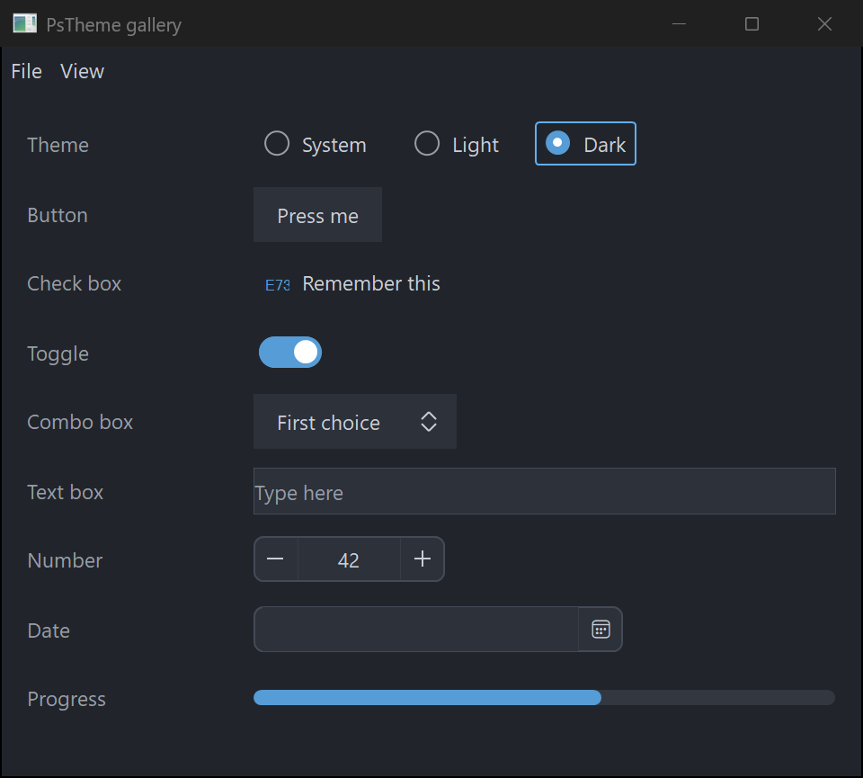
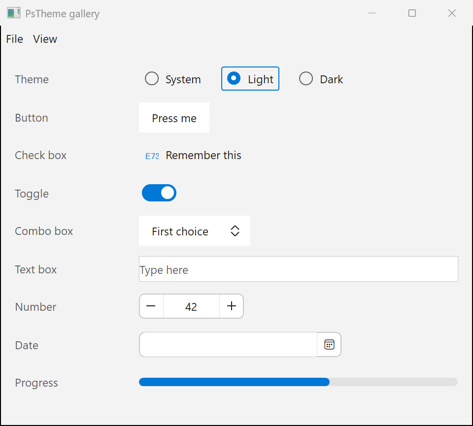

# PsTheme

The shared theme for PsControls. A theme is a set of **semantic roles**, not a colour for each
field of each control. Each control derives its own colours from the roles, so one theme
switch restyles every control in the program.

```freebasic
dim t as PSTHEME_COLORS = PsTheme_Dark( )
t.Accent = BGR( 0, 120, 215 )
app.SetTheme( t )                         ' every control and every form repaints

PsButton_SetColors( hDanger, @myRed )     ' pins this one button: the theme leaves it alone
PsButton_UnpinColors( hDanger )           ' ...until it is handed back
```

In a [PsApp](../PsApp/README.md) program you do nothing: the theme follows the Windows
light/dark setting (Settings › Personalisation › Colours) and switches live. You choose the mode
with `PSAPP_OPTIONS.ThemeMode` or `app.SetThemeMode( PSAPP_THEME_LIGHT )`.

`examples/PsControls/PsTheme` is a gallery of the common controls with a theme switch:

| Dark | Light |
|---|---|
|  |  |

## The roles (`PSTHEME_COLORS`)

| Role | Used for |
|---|---|
| `IsDark` | dark chrome (the title bar), and for the app's own choices |
| `Window` | the form background, and controls that sit flat on it |
| `Surface`, `SurfaceHot`, `SurfaceDisabled` | control faces: buttons, fields, bars |
| `Text`, `TextHot`, `TextStrong`, `TextDim`, `TextDisabled` | text: normal, under the mouse, emphasised (titles, pressed), secondary (captions, placeholders), disabled |
| `Accent`, `AccentHot` | checked, on, progress, today |
| `FocusRing` | focus rings and focused borders |
| `Border`, `BorderDisabled`, `Divider` | outlines, separators, grid lines |
| `Selected`, `SelectedText` | selection and pressed fill |
| `Popup`, `PopupText` | menus, dropdowns, tooltips |
| `Track` | the unfilled part of a track (toggle off, progress) |
| `Success`, `Warning`, `Error` | status colours |

## Presets

| Function | Theme |
|---|---|
| `PsTheme_Dark( )` | The family's built-in look. Every control's default colours are dark, and this preset is those defaults expressed as roles. A control default that uses a shade the roles do not have moves to the nearest role (RFC-0001 appendix A lists each one). |
| `PsTheme_Light( )` | Light |
| `PsTheme_System( )` | Dark or Light, following Windows. `PsTheme_SystemIsDark( )` tells you which. |

`PsTheme_ApplyTitleBar( hwnd, bDark )` makes a window's title bar and frame dark or light
through DWM. PsApp does this for every form.

`PsTheme_Equal( a, b )` compares two themes.

## Controls

Every control has these, beside its own `SetColors`:
- **`Ps<X>_ThemeColors( t )`**: the adapter. It returns the control's colour set derived from the roles. Only controls with a `PS<X>_COLORS` type have it.
- **`Ps<X>_ApplyTheme( h, t )`**: applies the theme, unless the colours are pinned.
- **`Ps<X>_UnpinColors( h )`**: hands the control back to the theme and applies the theme at once.
- **`Ps<X>_ApplyFonts( h, hText, hGlyph )`**: PsApp uses it to give a new control the fonts of its form.

**Pinning.** Any colour setter the program calls (`SetColors`, `SetBackColor`, and the rest)
*pins* the control's colours, and the theme then leaves that control alone. Item-level colours,
such as a chart series or a toolbar item's foreground, are data rather than theme: they are never
pinned and never themed.

Without a theme (no PsApp, or `PSAPP_THEME_NONE`), nothing changes: controls keep their
built-in colours, exactly as before.

Specified in `C:\dev\docs\tiko-psapp\RFC-0001-psapp.md` §8.
