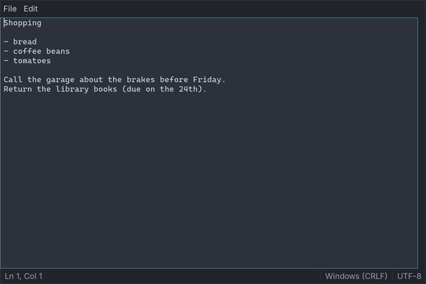

[Home](Home) › [tkControls](Category-tkControls) › **Notepad2 Tutorial**

# Notepad2 Tutorial

> 📘 **Start with:** [tkControls](Category-tkControls) and [tkApp](tkApp), the controls and the framework these steps use.
>
> 🪟 **The same program on PsControls:** the [Notepad Tutorial](Notepad-Tutorial). This page follows it step by step, so the two can be read side by side.

This tutorial builds **`tpad`** again, the plain-text editor of the [Notepad Tutorial](Notepad-Tutorial): a menu bar, the text, a scroll bar, a status bar with the line and column, Find, and a question before unsaved work is thrown away. This time it is built on **tkControls**, which draw into SDL3 windows, so **one source builds and runs on Windows and Linux**.

Most of the program does not change. The document module is the same file, word for word. The `Editor`, the commands and the one `Execute` are the same. What changes is what a window is made of: widgets instead of window handles, SDL events instead of Win32 messages. The program is about 800 lines of tiko, a sixth of them a self-test, and the self-test prints exactly what the PsControls one prints.



---

## 1. The project

```text
tpad/
    tiko.toml               the package, and the target tpad
    textfile/textfile.tiko  the document: load, save, find, line and column
    pad/pad.tiko            the window: controls, menus, commands
    tpad.tiko               the program, and its self-test
    expected.txt            what the self-test prints
```

The toolchain ships it as `examples/tkControls/tpad`. `textfile` imports no controls at all, `pad` is the window, and `tpad.tiko` starts it.

```toml
# tpad on tkControls: `tiko build tpad` writes tpad.exe
[package]
name = "tpad"

[target.tpad]
main   = "tpad.tiko"
output = "tpad.exe"
```

There is no `UNICODE` define, no resource file and no manifest. SDL3's strings are UTF-8 on every system, and SDL3 makes the window DPI-aware itself.

## 2. The document

The module keeps text with **one LF per line break**, so an offset in a `Document` is an offset in the text control. It is the Notepad Tutorial's `textfile` unchanged: nothing in it knew which controls would show it.

```freebasic
#module "textfile"
#import "std/fs"
#import "std/strings"
'' Nothing here knows about windows: this module is the part of tpad
'' that compiles, and is tested, on every target.
''
'' Unchanged from the Notepad Tutorial (the PsControls tpad): the
'' document never knew which control family would show it.

public enum LineEnding
    CrLf
    Lf
end enum

'' A text file as the editor sees it. Inside, every line break is one
'' LF, so an offset into Text is an offset into the editor control,
'' which also counts a line break as one character.
public type Document
    as ustring path             '' "" until the first Save As
    as ustring text
    as LineEnding ending = LineEnding.CrLf
    as boolean hasBom           '' the file began with a byte-order mark
    as boolean lossy            '' some bytes were not UTF-8
end type

'' CR LF and a lone CR both become LF.
public function ToLf( byref s as const ustring ) as ustring
    return strings.Replace( strings.Replace( s, !"\r\n", !"\n" ), _
                            !"\r", !"\n" )
end function
```

`TextOf` in the window module still passes the control's text through `ToLf`, so the rule holds whatever the control hands back.

Loading and saving keep a file the way it was written: its line ending, and its byte-order mark if it had one. `fs.ReadAllText` removes a mark and turns bytes that are not UTF-8 into U+FFFD, so the module reads the first three bytes itself and records a lossy load. `fs.WriteAtomic` replaces the old file only when the new one is complete.

```freebasic
'' Did the file start with a byte-order mark? Only its first three
'' bytes are read.
private function StartsWithBom( byref p as const ustring ) as boolean
    dim as fs.File f
    if f.OpenRead( p ).IsOk( ) = false then return false
    dim as ubyte b( 0 to 2 )
    var got = f.Read( @b( 0 ), 3 )
    if got.IsOk( ) = false then return false
    dim as longint n = got.Value( )
    if n >= 3 andalso b( 0 ) = &hEF andalso b( 1 ) = &hBB andalso _
       b( 2 ) = &hBF then return true
    return n >= 2 andalso b( 0 ) = &hFF andalso b( 1 ) = &hFE
end function

'' Reads a file into doc. Returns "" or what went wrong; on failure doc
'' is left as it was.
public function Load( byref p as const ustring, _
                      byref doc as Document ) as ustring
    var r = fs.ReadAllText( p )
    if r.IsOk( ) = false then return r.Failure( ).Message( )

    dim as Document d
    d.path = p
    dim as ustring raw = r.Value( )
    '' The first line break says how the file writes them.
    dim as int32 lf = instr( raw, !"\n" ), cr = instr( raw, !"\r" )
    if lf > 0 andalso cr <> lf - 1 then d.ending = LineEnding.Lf
    d.text = ToLf( raw )
    d.hasBom = StartsWithBom( p )
    d.lossy = instr( d.text, wchr( &hFFFD ) ) > 0
    doc = d
    return ""
end function

'' Writes doc.text to doc.path in the file's own line ending. The old
'' file is replaced only once the new one is complete on disk.
public function Save( byref doc as Document ) as ustring
    dim as ustring s = doc.text
    if doc.ending = LineEnding.CrLf then
        s = strings.Replace( s, !"\n", !"\r\n" )
    end if
    if doc.hasBom then s = wchr( &hFEFF ) & s
    var r = fs.WriteAtomic( doc.path, s )
    if r.IsOk( ) = false then return r.Failure( ).Message( )
    return ""
end function
```

> ⚠️ **`fs.ReadAllBytes( p, buf, 3 )` does not read three bytes.** The third argument is a size limit: any larger file is refused and nothing is read. Read a prefix with a `File`, as `StartsWithBom` does.

The title, the search and the status bar's numbers:

```freebasic
'' The file's name without its folder, or "Untitled".
public function DisplayName( byref doc as Document ) as ustring
    if len( doc.path ) = 0 then return "Untitled"
    dim as int32 i = len( doc.path )
    do until i = 0
        dim as ustring c = mid( doc.path, i, 1 )
        if c = "\" orelse c = "/" then exit do
        i -= 1
    loop
    return mid( doc.path, i + 1 )
end function

'' The title bar: "*notes.txt - tpad" while there are unsaved changes.
public function Caption( byref doc as Document, _
                         byval modified as boolean ) as ustring
    return iif( modified, "*", "" ) & DisplayName( doc ) & " - tpad"
end function

'' The offset of the next match at or after start, wrapping around to
'' the top; -1 when there is none. Offsets count from 0, as the editor
'' control's do.
public function FindNext( byref text as const ustring, _
                          byref needle as const ustring, _
                          byval start as int32, _
                          byval matchCase as boolean ) as int32
    if len( needle ) = 0 then return -1
    dim as ustring hay = text, pin = needle
    if matchCase = false then
        hay = lcase( hay )
        pin = lcase( pin )
    end if
    dim as int32 at = instr( start + 1, hay, pin )
    if at = 0 then at = instr( hay, pin )
    return at - 1
end function

'' The 1-based line and column of an offset, for the status bar.
public sub LineColumn( byref text as const ustring, _
                       byval offset as int32, _
                       byref ln as int32, byref col as int32 )
    ln = 1
    dim as int32 lineStart = 1, at = instr( text, !"\n" )
    do until at = 0 orelse at > offset
        ln += 1
        lineStart = at + 1
        at = instr( at + 1, text, !"\n" )
    loop
    col = offset + 2 - lineStart
end sub
```

> ⚠️ **Offsets in a tkTextBox are UTF-8 bytes.** `GetSel` and `SetSel` count bytes, snapped to character boundaries. For ASCII text they equal `textfile`'s offsets, and ASCII is all the self-test uses.

## 3. The window's state

```freebasic
#module "pad"
#import "../textfile"
#import "vendor/tkControls/tkApp"
#import "vendor/tkControls/tkMenuBar"
#import "vendor/tkControls/tkPopupMenu"
#import "vendor/tkControls/tkTextBox"
#import "vendor/tkControls/tkVScrollBar"
#import "vendor/tkControls/tkStatusBar"
#import "vendor/tkControls/tkMessageBox"
#import "vendor/tkControls/tkButton"
#import "vendor/tkControls/tkCheckBox"

using tkApp
using tkHost
using tkPaint
using tkTheme
using tkMenuBar
using tkPopupMenu
using tkTextBox
using tkVScrollBar
using tkStatusBar
using tkMessageBox
using tkButton
using tkCheckBox

'' The window of tpad, the Notepad Tutorial's editor, on tkControls: the
'' same Editor, the same commands, the same one Execute. What changed is
'' only what a window is made of.

'' Every command the menus and the keyboard can give.
public enum Cmd
    CmdNew = 1000
    CmdOpen
    CmdSave
    CmdSaveAs
    CmdExit
    CmdUndo
    CmdCut
    CmdCopy
    CmdPaste
    CmdSelectAll
    CmdFind
    CmdFindNext
end enum

'' The two things a person answers: a question in a message box, and
'' a file name in a file dialog. Each is reached through a pointer, so
'' a test can answer in the person's place.
public type AskProc as function( byval f as TK_FORM ptr, _
    byref text as ustring, byval buttons as long ) as long
public type PickProc as function( byval f as TK_FORM ptr, _
    byval saving as boolean, byref suggest as ustring ) as ustring

'' One open file and its window. The form's Tag points here.
public type Editor
    as TK_FORM ptr form
    as TK_WIDGET ptr bar, text, scroll, status
    as textfile.Document doc
    as ustring findWhat
    as boolean matchCase
    as AskProc ask
    as PickProc pick
end type

'' The Find box's controls. Its form's Tag points here.
type FindBox
    as Editor ptr ed
    as TK_WIDGET ptr what, matchCase, ok, cancel
end type

public declare sub Execute( byval ed as Editor ptr, byval id as long )
public declare sub ShowTitle( byval ed as Editor ptr )
public declare sub ShowStatus( byval ed as Editor ptr )

'' A control's callback receives only the control: its form's Tag is
'' the Editor.
function EditorOf( byval w as TK_WIDGET ptr ) as Editor ptr
    return tkForm_FromWidget( w )->Tag
end function
```

Everything about one window is an `Editor`, allocated with `new`, and **the form's `Tag` points at it**. A control is a `TK_WIDGET ptr`, and the `Editor` keeps one for each control it talks to: there is no `f->Item( id )` to look a control up by its id. A control's callback receives only the control; `tkForm_FromWidget` finds the form, and its `Tag` finds the `Editor`. The Find box works the same way with a `FindBox`.

`ask` and `pick` are the two places a person answers: a message box and a file dialog. They are procedure pointers so that a test can answer instead.

```freebasic
'' The real answers come from a person.
function AskPerson( byval f as TK_FORM ptr, byref text as ustring, _
                    byval buttons as long ) as long
    return tkMessageBox_Show( tkForm_Widget( f ), text, "tpad", _
        iif( buttons = MBX_BTN_OK, MBX_ICON_INFO, MBX_ICON_QUESTION ), _
        buttons )
end function

'' SDL's file dialogs are asynchronous: the answer arrives in a callback,
'' perhaps on another thread. PickFile waits for it, pumping, so its
'' caller sees a plain function -- as a modal Win32 dialog was.
dim shared as SDL_AtomicInt gPickState      '' 0 waiting, 1 answered
dim shared as ustring gPicked

sub PickAnswered( byval userdata as any ptr, _
                  byval filelist as const zstring const ptr ptr, _
                  byval filter as long )
    gPicked = ""
    if filelist <> 0 then
        if filelist[0] <> 0 then gPicked = *filelist[0]
    end if
    SDL_SetAtomicInt( @gPickState, 1 )
end sub

function PickFile( byval f as TK_FORM ptr, byval saving as boolean, _
                   byref suggest as ustring ) as ustring
    dim as SDL_DialogFileFilter filters( 0 to 1 )
    filters( 0 ).name = @"Text files" : filters( 0 ).pattern = @"txt"
    filters( 1 ).name = @"All files" : filters( 1 ).pattern = @"*"
    dim as string where = suggest
    SDL_SetAtomicInt( @gPickState, 0 )
    dim as SDL_Window ptr win = tkForm_Host( f )->win
    if saving then
        SDL_ShowSaveFileDialog( @PickAnswered, 0, win, @filters( 0 ), 2, _
                                iif( len( where ), strptr( where ), 0 ) )
    else
        SDL_ShowOpenFileDialog( @PickAnswered, 0, win, @filters( 0 ), 2, _
                                0, false )
    end if
    do until SDL_GetAtomicInt( @gPickState ) = 1
        tkApp_Pump( )
        SDL_Delay( 10 )
    loop
    return gPicked
end function
```

SDL's file dialogs do not block: they return at once and answer later, in a callback that may run on another thread. `PickFile` waits for that answer and keeps the window alive while it does, so its callers see a plain function that returns a path, as they would with a modal dialog.

## 4. The text, its scroll bar and the status bar

```freebasic
'' What the message callback saw is acted on once the box has moved its
'' caret: tkApp_RunOnUI does what PostMessage did.
sub CaretMoved( byval payload as any ptr )
    ShowStatus( payload )
end sub

sub BuildText( byval f as TK_FORM ptr, byval ed as Editor ptr )
    ed->text = tkTextBox_Create( tkForm_Widget( f ), 101, true )
    tkTextBox_SetFont( ed->text, tkForm_Font( f, TKFONT_MONO ) )
    tkTextBox_SetLimitText( ed->text, &h7FFFFFFE )
    tkTextBox_SetMargins( ed->text, tkForm_Scale( f, 6 ), tkForm_Scale( f, 6 ) )

    '' The person typed, cut, pasted or undid something.
    tkTextBox_SetChangeCallback( ed->text, _
        sub( byval h as TK_WIDGET ptr )
            ShowTitle( EditorOf( h ) )
            ShowStatus( EditorOf( h ) )
        end sub )

    '' The caret may have moved: look once the control has acted.
    tkTextBox_SetMessageCallback( ed->text, _
        function( byval m as TKTEXTBOX_MESSAGEINFO ptr ) as boolean
            select case m->msg
            case TKM_KEYDOWN, TKM_KEYUP, TKM_LBUTTONDOWN, TKM_LBUTTONUP
                tkApp_RunOnUI( @CaretMoved, EditorOf( m->hTextBox ) )
            end select
            return false
        end function )

    '' The control draws no scroll bar unless asked; like the tutorial,
    '' tpad gives it one of its own and wires the two together.
    ed->scroll = tkVScrollBar_Create( tkForm_Widget( f ), 102 )
    tkTextBox_SetScrollChangedCallback( ed->text, _
        sub( byval h as TK_WIDGET ptr )
            dim as integer total, page, top
            tkTextBox_GetVScrollInfo( h, total, page, top )
            tkVScrollBar_SetRange( EditorOf( h )->scroll, total, page, top )
        end sub )
    tkVScrollBar_SetScrollCallback( ed->scroll, _
        sub( byval h as TK_WIDGET ptr, byval newPos as integer )
            tkTextBox_ScrollToLine( EditorOf( h )->text, newPos )
        end sub )
end sub
```

- **The change callback** fires only for the person's edits. Setters such as `tkTextBox_SetText` are silent.
- **The message callback** runs *before* the box acts on a key or a click. `tkApp_RunOnUI` queues `CaretMoved` to run once the event has been handled, when the caret has moved.
- **The box draws no scroll bar unless asked.** It reports its line count, page and top line, and a `tkVScrollBar` reports where it was dragged.

```freebasic
sub BuildStatus( byval f as TK_FORM ptr, byval ed as Editor ptr )
    ed->status = tkStatusBar_Create( tkForm_Widget( f ), 103 )
    tkStatusBar_AddPanel( ed->status, "" )      '' Ln, Col: springs
    tkStatusBar_AddPanel( ed->status, "" )      '' line ending
    tkStatusBar_AddPanel( ed->status, "" )      '' encoding
    tkStatusBar_SetExpandPanel( ed->status, 0 )
    '' No paint callback: tkStatusBar draws its panels itself.
end sub

'' The editor's text, with one LF per line break, as textfile wants.
function TextOf( byval ed as Editor ptr ) as ustring
    return textfile.ToLf( tkTextBox_GetText( ed->text ) )
end function

public sub ShowTitle( byval ed as Editor ptr )
    dim as string t8 = textfile.Caption( ed->doc, tkTextBox_GetModify( ed->text ) )
    SDL_SetWindowTitle( tkForm_Host( ed->form )->win, strptr( t8 ) )
end sub

public sub ShowStatus( byval ed as Editor ptr )
    dim as integer first, last
    tkTextBox_GetSel( ed->text, first, last )
    dim as int32 ln, col
    textfile.LineColumn( TextOf( ed ), last, ln, col )
    tkStatusBar_SetText( ed->status, 0, "Ln " & ln & ", Col " & col )
    tkStatusBar_SetText( ed->status, 1, _
        iif( ed->doc.ending = textfile.LineEnding.CrLf, _
             "Windows (CRLF)", "Unix (LF)" ) )
    tkStatusBar_SetText( ed->status, 2, _
        iif( ed->doc.hasBom, "UTF-8 with BOM", "UTF-8" ) )
end sub
```

A `tkStatusBar` draws its panels itself, so setting a panel's text is all there is to do. The window title goes to SDL as UTF-8: `t8` is a `string` holding the caption's bytes.

## 5. Layout, menus and commands

```freebasic
sub Main_OnSize( byval f as TK_FORM ptr, byval cx as long, byval cy as long )
    dim as Editor ptr ed = f->Tag
    dim as long barH = tkForm_Scale( f, 30 ), statusH = tkForm_Scale( f, 26 )
    dim as long sbW = tkForm_Scale( f, 14 )
    dim as long textH = cy - barH - statusH
    tkWidget_SetPos( ed->bar, 0, 0, cx, barH )
    tkWidget_SetPos( ed->text, 0, barH, cx - sbW, textH )
    tkWidget_SetPos( ed->scroll, cx - sbW, barH, sbW, textH )
    tkWidget_SetPos( ed->status, 0, cy - statusH, cx, statusH )
end sub
```

Controls start with no size; `OnSize` places them. Every literal goes through `tkForm_Scale`, which turns a design value into pixels at the form's scale.

```freebasic
function AddMenu( byval f as TK_FORM ptr, byval bar as TK_WIDGET ptr, _
                  byref title as ustring ) as TK_MENU ptr
    dim as long i = tkMenuBar_AddItem( bar, title, 0 )
    dim as TK_MENU ptr m = tkPopupMenu_Create( tkForm_Host( f ) )
    tkMenuBar_SetDropDown( bar, i, m )
    return m
end function

sub BuildMenus( byval f as TK_FORM ptr, byval ed as Editor ptr )
    dim as TK_WIDGET ptr bar = tkMenuBar_Create( tkForm_Widget( f ), 100 )
    ed->bar = bar
    tkMenuBar_SetCommandCallback( bar, _
        sub( byval h as TK_WIDGET ptr, byval id as long )
            Execute( EditorOf( h ), id )
        end sub )
    dim as TK_MENU ptr m = AddMenu( f, bar, "File" )
    tkPopupMenu_AddItem( m, CmdNew, "New", "Ctrl+N" )
    tkPopupMenu_AddItem( m, CmdOpen, "Open...", "Ctrl+O" )
    tkPopupMenu_AddItem( m, CmdSave, "Save", "Ctrl+S" )
    tkPopupMenu_AddItem( m, CmdSaveAs, "Save As...", "Ctrl+Shift+S" )
    tkPopupMenu_AddSeparator( m )
    tkPopupMenu_AddItem( m, CmdExit, "Exit" )
    m = AddMenu( f, bar, "Edit" )
    tkPopupMenu_AddItem( m, CmdUndo, "Undo", "Ctrl+Z" )
    tkPopupMenu_AddSeparator( m )
    tkPopupMenu_AddItem( m, CmdCut, "Cut", "Ctrl+X" )
    tkPopupMenu_AddItem( m, CmdCopy, "Copy", "Ctrl+C" )
    tkPopupMenu_AddItem( m, CmdPaste, "Paste", "Ctrl+V" )
    tkPopupMenu_AddItem( m, CmdSelectAll, "Select All", "Ctrl+A" )
    tkPopupMenu_AddSeparator( m )
    tkPopupMenu_AddItem( m, CmdFind, "Find...", "Ctrl+F" )
    tkPopupMenu_AddItem( m, CmdFindNext, "Find Next", "F3" )

    '' There is no accelerator table: the text box handles Ctrl+Z, X, C,
    '' V and A and leaves every other key unclaimed, so the keys only tpad
    '' knows bubble up to the form.
    tkForm_OnKeyDown( f, _
        function( byval f as TK_FORM ptr, byval key as long, _
                  byval mods as long ) as boolean
            dim as boolean ctrl = (mods and SDL_KMOD_CTRL) <> 0
            dim as boolean shift = (mods and SDL_KMOD_SHIFT) <> 0
            dim as long id = 0
            if ctrl then
                select case key
                case SDLK_N : id = CmdNew
                case SDLK_O : id = CmdOpen
                case SDLK_S : id = iif( shift, CmdSaveAs, CmdSave )
                case SDLK_F : id = CmdFind
                end select
            elseif key = SDLK_F3 then
                id = CmdFindNext
            end if
            if id = 0 then return false
            Execute( f->Tag, id )
            return true
        end function )
end sub
```

The text box handles Ctrl+Z, X, C, V and A itself, and **leaves every other key unclaimed**, so a key it does not use bubbles up to the form. `tkForm_OnKeyDown` turns Ctrl+N, Ctrl+O, Ctrl+S, Ctrl+Shift+S, Ctrl+F and F3 into commands; returning `true` says the key was used. Menus, keys and the self-test all end in the one `Execute`:

```freebasic
'' The one place a command is carried out, wherever it came from.
public sub Execute( byval ed as Editor ptr, byval id as long )
    select case id
    case CmdNew
        if MayDiscard( ed ) then
            dim as textfile.Document blank
            ShowDocument( ed, blank )
        end if
    case CmdOpen
        if MayDiscard( ed ) then
            dim as ustring p = ed->pick( ed->form, false, "" )
            if len( p ) then OpenPath( ed, p )
        end if
    case CmdSave
        SaveDocument( ed, false )
    case CmdSaveAs
        SaveDocument( ed, true )
    case CmdExit
        tkForm_Close( ed->form )
    case CmdUndo
        tkTextBox_Undo( ed->text )
    case CmdCut
        tkTextBox_Cut( ed->text )
    case CmdCopy
        tkTextBox_Copy( ed->text )
    case CmdPaste
        tkTextBox_Paste( ed->text )
    case CmdSelectAll
        tkTextBox_SelectAll( ed->text )
    case CmdFind
        AskWhatToFind( ed )
    case CmdFindNext
        if len( ed->findWhat ) then
            FindAgain( ed )
        else
            AskWhatToFind( ed )
        end if
    end select
end sub
```

## 6. Files, Find, and building the window

```freebasic
'' Puts doc in the window, replacing what was there.
sub ShowDocument( byval ed as Editor ptr, byref doc as textfile.Document )
    ed->doc = doc
    tkTextBox_SetText( ed->text, doc.text )
    tkTextBox_SetModify( ed->text, false )
    tkTextBox_SetSel( ed->text, 0, 0 )
    ShowTitle( ed )
    ShowStatus( ed )
end sub

'' Opens path; says why not if it cannot.
public function OpenPath( byval ed as Editor ptr, byref path as ustring ) as boolean
    dim as textfile.Document doc
    dim as ustring e = textfile.Load( path, doc )
    if len( e ) then
        ed->ask( ed->form, e, MBX_BTN_OK )
        return false
    end if
    ShowDocument( ed, doc )
    if doc.lossy then
        ed->ask( ed->form, textfile.DisplayName( doc ) & _
            " is not UTF-8. Characters that could not be read show" & _
            " as U+FFFD, and saving writes them that way.", MBX_BTN_OK )
    end if
    return true
end function

'' Saves, asking for a name when there is none (or when asked to).
function SaveDocument( byval ed as Editor ptr, byval newName as boolean ) as boolean
    if newName orelse len( ed->doc.path ) = 0 then
        dim as ustring p = ed->pick( ed->form, true, textfile.DisplayName( ed->doc ) )
        if len( p ) = 0 then return false
        ed->doc.path = p
    end if
    ed->doc.text = TextOf( ed )
    dim as ustring e = textfile.Save( ed->doc )
    if len( e ) then
        ed->ask( ed->form, e, MBX_BTN_OK )
        return false
    end if
    tkTextBox_SetModify( ed->text, false )
    ShowTitle( ed )
    return true
end function

'' True when it is all right to throw the text away: it is saved,
'' the person saved it now, or said not to.
function MayDiscard( byval ed as Editor ptr ) as boolean
    if tkTextBox_GetModify( ed->text ) = false then return true
    select case ed->ask( ed->form, "Do you want to save changes to " & _
                         textfile.DisplayName( ed->doc ) & "?", _
                         MBX_BTN_SAVE_DONTSAVE_CANCEL )
    case MBX_IDYES
        return SaveDocument( ed, false )
    case MBX_IDNO
        return true
    end select
    return false
end function

sub FindAgain( byval ed as Editor ptr )
    if len( ed->findWhat ) = 0 then exit sub
    dim as integer first, last
    tkTextBox_GetSel( ed->text, first, last )
    dim as int32 at = textfile.FindNext( TextOf( ed ), ed->findWhat, last, ed->matchCase )
    if at < 0 then
        ed->ask( ed->form, "Cannot find """ & ed->findWhat & """", MBX_BTN_OK )
        exit sub
    end if
    '' SetSel scrolls the caret into view itself (no EM_SCROLLCARET).
    tkTextBox_SetSel( ed->text, at, at + len( ed->findWhat ) )
    ShowStatus( ed )
end sub
```

`tkTextBox_SetSel` scrolls the caret into view itself, so `FindAgain` needs nothing after it.

```freebasic
'' The Find box: a modal form that only collects the search.
sub FindBox_OnSize( byval f as TK_FORM ptr, byval cx as long, byval cy as long )
    '' Two rows, each as tall as a button: the search and its button,
    '' then the option and Cancel.
    dim as FindBox ptr box = f->Tag
    dim as long pad = tkForm_Scale( f, 12 ), bw, bh
    tkButton_GetIdealSize( box->ok, bw, bh )
    dim as long w = cx - 3 * pad - bw
    tkWidget_SetPos( box->what, pad, pad, w, bh )
    tkWidget_SetPos( box->matchCase, pad, 2 * pad + bh, w, bh )
    tkWidget_SetPos( box->ok, cx - pad - bw, pad, bw, bh )
    tkWidget_SetPos( box->cancel, cx - pad - bw, 2 * pad + bh, bw, bh )
end sub

sub FindBox_Accept( byval box as FindBox ptr )
    box->ed->findWhat = tkTextBox_GetText( box->what )
    box->ed->matchCase = tkCheckBox_GetChecked( box->matchCase )
    tkForm_EndModal( tkForm_FromWidget( box->what ), TKAPP_IDOK )
end sub

sub AskWhatToFind( byval ed as Editor ptr )
    dim as TK_FORM ptr f = tkApp_NewForm( "Find", 420, 112, ed->form )
    dim as FindBox box
    box.ed = ed
    f->Tag = @box
    box.what = tkTextBox_Create( tkForm_Widget( f ), 104 )
    tkTextBox_SetText( box.what, ed->findWhat )
    tkTextBox_SetSelectOnFocus( box.what, true )
    '' Enter in the search is the default button's job in Win32; here the
    '' single-line box reports Enter, and that is Find Next.
    tkTextBox_SetEnterPressedCallback( box.what, _
        sub( byval h as TK_WIDGET ptr )
            FindBox_Accept( tkForm_FromWidget( h )->Tag )
        end sub )
    box.matchCase = tkCheckBox_Create( tkForm_Widget( f ), 105 )
    tkCheckBox_SetText( box.matchCase, "Match case" )
    tkCheckBox_SetChecked( box.matchCase, ed->matchCase )
    box.ok = tkButton_Create( tkForm_Widget( f ), TKAPP_IDOK )
    tkButton_SetText( box.ok, "Find Next" )
    tkButton_SetClickCallback( box.ok, _
        sub( byval h as TK_WIDGET ptr, byval id as long )
            FindBox_Accept( tkForm_FromWidget( h )->Tag )
        end sub )
    box.cancel = tkButton_Create( tkForm_Widget( f ), TKAPP_IDCANCEL )
    tkButton_SetText( box.cancel, "Cancel" )
    tkButton_SetClickCallback( box.cancel, _
        sub( byval h as TK_WIDGET ptr, byval id as long )
            tkForm_EndModal( tkForm_FromWidget( h ), TKAPP_IDCANCEL )
        end sub )
    tkForm_OnSize( f, @FindBox_OnSize )
    '' Esc ends a modal form with IDCANCEL by itself.
    if tkForm_ShowModal( f ) = TKAPP_IDOK then FindAgain( ed )
end sub
```

The Find box is a modal form. `tkForm_ShowModal` returns only once the box is closed, so its `FindBox` can live on the stack of `AskWhatToFind`. Enter in the search box is Find Next, through the box's Enter callback, and Esc closes a modal form with `TKAPP_IDCANCEL` by itself.

```freebasic
'' Builds the main window, with an empty, untitled document.
public function Create( byval forcedScale as single = 0 ) as Editor ptr
    dim as Editor ptr ed = new Editor
    ed->ask = @AskPerson
    ed->pick = @PickFile
    dim as TK_FORM ptr f = tkApp_NewForm( "tpad", 720, 480, 0, forcedScale )
    ed->form = f
    f->Tag = ed

    BuildMenus( f, ed )
    BuildText( f, ed )
    BuildStatus( f, ed )

    tkForm_OnSize( f, @Main_OnSize )
    '' Asked before the window closes, however it is closed.
    tkForm_OnClose( f, _
        function( byval f as TK_FORM ptr ) as boolean
            return MayDiscard( f->Tag )
        end function )
    '' No OnScaleChanged: a scale change re-sizes the fonts a control was
    '' given; it never hands every control the UI font, so the text stays
    '' monospaced by itself.
    tkForm_OnDestroy( f, _
        sub( byval f as TK_FORM ptr )
            delete cast( Editor ptr, f->Tag )
            f->Tag = 0
        end sub )

    ShowTitle( ed )
    ShowStatus( ed )
    return ed
end function
```

`MayDiscard` asks Save, Don't Save or Cancel before New, Open or closing; returning `false` from `OnClose` keeps the window open.

A change of display scale re-sizes the fonts the controls were given and changes nothing else, so the text stays monospaced without any code. `forcedScale` pins a scale instead of the display's; the self-test uses it, so its layout is the same on every machine.

## 7. The program

```freebasic
#cmdline "-s gui"
#import "std/fs"
#import "std/strings"
#import "./pad"
#import "vendor/tkControls/tkApp"
#import "vendor/tkControls/tkTextBox"
#import "vendor/tkControls/tkStatusBar"
#import "vendor/tkControls/tkMessageBox"

using tkApp
using tkHost
using tkTextBox
using tkStatusBar
using tkMessageBox

'' tpad, the Notepad Tutorial's editor, on tkControls (SDL3 + SDL_ttf):
'' the same program on Windows and Linux.
''
''   tpad [file]                 run it
''   tpad --selftest             drive the real window, print what it saw
''   tpad --shot out.bmp [file]  render once (dark theme) and save it

' ... the self-test, in the next section ...

'' ---- the program ----

dim as string cmd1 = command( 1 )
dim as TKAPP_OPTIONS opts
if (cmd1 = "--selftest") orelse (cmd1 = "--shot") then opts.ThemeMode = TKAPP_THEME_DARK
if tkApp_Init( opts ) = false then print "tkApp_Init: " & *SDL_GetError( ) : end 1
' the self-test runs at 1.0, a shot at 1.75 (so shots from two platforms compare), and the
' program at the display's own scale unless TPAD_SCALE pins one
dim as single scale_ = val( environ( "TPAD_SCALE" ) )
if cmd1 = "--selftest" then scale_ = 1.0
if cmd1 = "--shot" then scale_ = 1.75
dim as pad.Editor ptr ed = pad.Create( scale_ )
if cmd1 = "--selftest" then
    dim as long r = SelfTest( ed )
    tkApp_Shutdown( )
    end r
end if
if cmd1 = "--shot" then
    if len( command( 3 ) ) then pad.OpenPath( ed, command( 3 ) )
    tkForm_Show( ed->form )
    dim as Uint64 t0 = SDL_GetTicks( )
    while SDL_GetTicks( ) - t0 < 300
        tkApp_Pump( )
        SDL_Delay( 10 )
    wend
    dim as TK_HOST ptr h = tkForm_Host( ed->form )
    tkHost_Render( h )
    tkHost_RenderTo( h, false )
    dim as SDL_Surface ptr s = SDL_RenderReadPixels( h->renderer, 0 )
    dim as string shot = command( 2 )
    if s then SDL_SaveBMP( s, strptr( shot ) ) : SDL_DestroySurface( s )
    tkApp_Shutdown( )
    end 0
end if
if len( cmd1 ) then pad.OpenPath( ed, cmd1 )
end tkApp_Run( ed->form )
```

`-s gui` means no console window on Windows. `tkApp_Run` shows the main window and runs the event loop until it closes.

`--shot` renders the window once, in the dark theme at a scale of 1.75, and saves it as a bitmap: the picture at the top of this page was made with it. `TPAD_SCALE` pins the scale of an ordinary run, which is useful for trying the layout at a scale the display does not have.

Build and run it from the project folder:

```text
tiko build tpad
./tpad.exe notes.txt
```

The first build compiles the tkControls modules the program imports; later builds compile only what changed. The build copies what the program needs at run time beside it: the bundled fonts and their licences and, on Windows, the SDL3, SDL3_ttf and SDL3_image libraries. On Linux the program uses the system's SDL3 libraries; see [tkControls](Category-tkControls) for what to install. `tiko build tpad --profile release` writes an optimised build: on Windows `tpad.exe` is 331,776 bytes, and that folder is the whole installation.

## 8. Testing the window with nobody at it

`tpad --selftest` drives the real window and prints what it saw. The message box and the file dialog are scripted through `ask` and `pick`; keys and typed text are SDL events, pushed onto the queue where the system would put them:

```freebasic
'' ---- the self-test (the Notepad Tutorial's, with SDL events for Win32 messages) ----

'' The person, scripted: what the test answers to each question.
function ScriptedAsk( byval f as TK_FORM ptr, byref text as ustring, _
                      byval buttons as long ) as long
    static as long replies( ... ) = { MBX_IDCANCEL, MBX_IDNO, MBX_IDNO }
    static as int32 n
    print "  asked: "; text
    if buttons = MBX_BTN_OK then return MBX_IDOK
    n += 1
    print "  answered: "; iif( replies( n - 1 ) = MBX_IDNO, _
                               "Don't Save", "Cancel" )
    return replies( n - 1 )
end function

function ScriptedPick( byval f as TK_FORM ptr, byval saving as boolean, _
                       byref suggest as ustring ) as ustring
    print "  picked: lf.tmp"
    return "lf.tmp"
end function

'' Lets queued events arrive, as the loop would.
sub Pump( )
    tkApp_Pump( )
end sub

'' A key, delivered where the keyboard would deliver it.
sub Press( byval ed as pad.Editor ptr, byval key as long )
    dim as SDL_Event e
    e.type = SDL_EVENT_KEY_DOWN
    e.key.windowID = tkForm_Host( ed->form )->winId
    e.key.key = key
    e.key.down = true
    SDL_PushEvent( @e )
    Pump( )
end sub

'' Typed text, as the OS hands it over after the keys: UTF-8. The event
'' points at this string, so it lives until the event has been handled.
dim shared as string gTyped
sub Type_( byval ed as pad.Editor ptr, byref s as ustring )
    gTyped = s
    dim as SDL_Event e
    e.type = SDL_EVENT_TEXT_INPUT
    e.text.windowID = tkForm_Host( ed->form )->winId
    e.text.text = strptr( gTyped )
    SDL_PushEvent( @e )
    Pump( )
end sub

sub Report( byval ed as pad.Editor ptr )
    dim as ustring title = *SDL_GetWindowTitle( tkForm_Host( ed->form )->win )
    print "  title:  "; title
    print "  status: "; tkStatusBar_GetText( ed->status, 0 ); " | "; _
          tkStatusBar_GetText( ed->status, 1 ); " | "; _
          tkStatusBar_GetText( ed->status, 2 )
end sub

function SelfTest( byval ed as pad.Editor ptr ) as long
    ed->ask = @ScriptedAsk
    ed->pick = @ScriptedPick
    fs.WriteAllText( "lf.tmp", !"one\ntwo\nthree\n" )
    dim as TK_HOST ptr h = tkForm_Host( ed->form )
    tkForm_Show( ed->form )
    Pump( )

    print "== a new window"
    Report( ed )
    print "== the layout, at 600 x 400"
    SDL_SetWindowSize( h->win, 600, 400 )
    dim as Uint64 t0 = SDL_GetTicks( )
    while SDL_GetTicks( ) - t0 < 300
        Pump( )
        SDL_Delay( 10 )
    wend
    print "  text meets the scroll bar: "; _
          cbool( ed->text->x + ed->text->cw = ed->scroll->x )
    print "  text meets the status bar: "; _
          cbool( ed->text->y + ed->text->ch = ed->status->y )
    print "  status bar is as wide as the window: "; _
          cbool( ed->status->cw = h->root->cw )

    print "== File > Open"
    pad.Execute( ed, pad.CmdOpen )
    Report( ed )
    print "== Down, Down, End, and type ""!"""
    tkHost_SetFocus( h, ed->text )
    Press( ed, SDLK_DOWN )
    Press( ed, SDLK_DOWN )
    Press( ed, SDLK_END )
    Type_( ed, "!" )
    Report( ed )

    print "== Find Next, for ""T"", twice"
    ed->findWhat = "T"
    pad.Execute( ed, pad.CmdFindNext )
    Report( ed )
    pad.Execute( ed, pad.CmdFindNext )
    Report( ed )
    print "== Find Next, for ""four"""
    ed->findWhat = "four"
    pad.Execute( ed, pad.CmdFindNext )

    print "== File > Save"
    pad.Execute( ed, pad.CmdSave )
    Report( ed )
    dim as ustring saved = fs.ReadAllText( "lf.tmp" ).Value( )
    print "  on disk: "; strings.Escape( saved )

    print "== type, then File > New, twice"
    Type_( ed, "?" )
    pad.Execute( ed, pad.CmdNew )
    Report( ed )
    pad.Execute( ed, pad.CmdNew )
    Report( ed )

    '' Win32 sent WM_DPICHANGED; here the surface's scale doubles and
    '' SDL says so.
    print "== moved to a monitor at twice the DPI"
    h->fScaleForced = 2 * h->fScale
    dim as SDL_Event e
    e.type = SDL_EVENT_WINDOW_DISPLAY_SCALE_CHANGED
    e.window.windowID = h->winId
    SDL_PushEvent( @e )
    Pump( )
    print "  the text is still monospaced: "; _
          cbool( tkTextBox_GetFont( ed->text ) = _
                 tkForm_Font( ed->form, TKFONT_MONO ) )

    print "== type, then close the window"
    Type_( ed, "x" )
    tkForm_Close( ed->form )
    print "  window closed: "; cbool( h->bQuit )
    fs.RemoveFile( "lf.tmp" )
    return 0
end function
```

Its output, the same on Windows and Linux, and line for line the same as the [Notepad Tutorial](Notepad-Tutorial#8-testing-the-window-with-nobody-at-it)'s:

```text
== a new window
  title:  Untitled - tpad
  status: Ln 1, Col 1 | Windows (CRLF) | UTF-8
== the layout, at 600 x 400
  text meets the scroll bar: true
  text meets the status bar: true
  status bar is as wide as the window: true
== File > Open
  picked: lf.tmp
  title:  lf.tmp - tpad
  status: Ln 1, Col 1 | Unix (LF) | UTF-8
== Down, Down, End, and type "!"
  title:  *lf.tmp - tpad
  status: Ln 3, Col 7 | Unix (LF) | UTF-8
== Find Next, for "T", twice
  title:  *lf.tmp - tpad
  status: Ln 2, Col 2 | Unix (LF) | UTF-8
  title:  *lf.tmp - tpad
  status: Ln 3, Col 2 | Unix (LF) | UTF-8
== Find Next, for "four"
  asked: Cannot find "four"
== File > Save
  title:  lf.tmp - tpad
  status: Ln 3, Col 2 | Unix (LF) | UTF-8
  on disk: one\ntwo\nthree!\n
== type, then File > New, twice
  asked: Do you want to save changes to lf.tmp?
  answered: Cancel
  title:  *lf.tmp - tpad
  status: Ln 3, Col 2 | Unix (LF) | UTF-8
  asked: Do you want to save changes to lf.tmp?
  answered: Don't Save
  title:  Untitled - tpad
  status: Ln 1, Col 1 | Windows (CRLF) | UTF-8
== moved to a monitor at twice the DPI
  the text is still monospaced: true
== type, then close the window
  asked: Do you want to save changes to Untitled?
  answered: Don't Save
  window closed: true
```

- **Size the window, then wait.** The system applies a new window size when it gets to it, so `SelfTest` pumps for a moment before it checks the layout. A key sent to a text box with no size moves nothing.
- **An event's text must outlive the event.** `SDL_EVENT_TEXT_INPUT` points at its string; `gTyped` keeps the string until the event has been handled.
- **Pump after every event.** `SDL_PushEvent` only queues it; `tkApp_Pump` hands it to the window, as the loop would.
- **Look at the window too.** The self-test checks commands, callbacks and files, not pixels: `tpad --shot` is for that.

## 9. What changed from the PsControls tpad

| [Notepad Tutorial](Notepad-Tutorial) (PsControls) | Here (tkControls) |
| --- | --- |
| `PsApplication`, `PsForm`, `f->hWindow`, `f->Item( id )` | `tkApp_Init`, `TK_FORM`, `tkForm_Widget( f )`; the `Editor` keeps its widget pointers |
| `PsForm.FromHwnd( h )->Tag` | `tkForm_FromWidget( w )->Tag` |
| `PostMessageW( WM_CARETMOVED )`, handled in `OnMessage` | `tkApp_RunOnUI( @CaretMoved, ed )` |
| An accelerator table | `tkForm_OnKeyDown`: keys the text box leaves unclaimed reach the form |
| `CISaveFileDialog` and `CIOpenFileDialog` | `SDL_ShowSaveFileDialog` and `SDL_ShowOpenFileDialog`, waited for by `PickFile` |
| `SetWindowTextW` and `GetWindowTextW` | `SDL_SetWindowTitle` and `SDL_GetWindowTitle`, in UTF-8 |
| `EM_SCROLLCARET` after `SetSel` | Nothing: `tkTextBox_SetSel` scrolls the caret into view |
| A status bar paint callback | Nothing: `tkStatusBar` draws its panels |
| `OnDpiChanged` puts the monospaced font back | Nothing: a scale change keeps each control's font |
| The Find box's default button takes Enter | The search box's Enter callback |
| `IDYES`, `IDNO` | `MBX_IDYES`, `MBX_IDNO`; the same `MBX_BTN_*` |
| `tpad.rc` and a manifest | Nothing: SDL3 makes the window DPI-aware |
| `WM_KEYDOWN` and `WM_CHAR` in the self-test | `SDL_EVENT_KEY_DOWN` and `SDL_EVENT_TEXT_INPUT` |
| `WM_DPICHANGED` in the self-test | A doubled scale and `SDL_EVENT_WINDOW_DISPLAY_SCALE_CHANGED` |

### See also

- [Notepad Tutorial](Notepad-Tutorial): the same program on PsControls
- [tkApp](tkApp)
- [tkTextBox](tkTextBox), [tkStatusBar](tkStatusBar), [tkMenuBar](tkMenuBar), [tkMessageBox](tkMessageBox)
- [SDL3 Tutorial](SDL3-Tutorial)
- [tiko build](Category-Tiko-Build)
- [Filesystem](Category-Filesystem)
